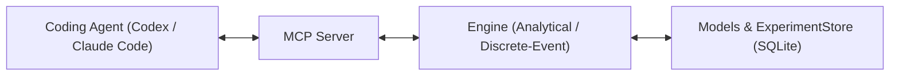

# ChipLab

<!-- mcp-name: io.github.everett6/chiplab -->

[](https://github.com/everett6/chiplab/actions/workflows/ci.yml)
[](LICENSE)


Chip architecture exploration for coding agents. ChipLab is an MCP server (and Python
library) that lets Claude Code, Codex, Gemini CLI or ChatGPT design a chiplet-based chip and
check it: performance (roofline or tile-level discrete-event simulation), power and thermal,
and unit cost from wafer prices, yield, memory $/GB, packaging, test and mask NRE. Every
number carries a provenance (measured / published / estimated / assumed) and every result a
fidelity level and disclaimer.

## 60-second quickstart

```bash
git clone https://github.com/everett6/chiplab.git
cd chiplab
python -m venv .venv && . .venv/bin/activate
pip install -e ".[dev]"
python - <<'PY'
from chiplab.mcp_server import chip_design_from_template, chip_evaluate
d = chip_design_from_template("edge_npu")
r = chip_evaluate(d["design_id"], workload={"type": "llm_decode", "model_params_b": 8})
print(r["performance"]["throughput_tokens_per_sec"], r["cost"]["unit_cost_usd"],
      r["efficiency"], r["bottleneck"]["primary_bottleneck"])
PY
```

Output (edge NPU, N4 + LPDDR5X, 8B-parameter decode):

| metric | value |
|---|---|
| peak compute | 40 TOPS |
| decode throughput | 8.5 tokens/s (memory-bandwidth bound) |
| power / temperature | 5.0 W / 55 C |
| unit cost | $85 typical ($59 to $166) |
| efficiency | 8.0 TOPS/W, $2.12 per peak TOPS |
| constraints | power, temperature and cost all pass |

Then connect an agent (see [MCP setup](#mcp-setup-claude-code-codex-gemini-cli-chatgpt)) and
ask it to design something: it will call `chip_quickstart`, `chip_design_from_template`
/`chip_create_design` and `chip_evaluate`.

## Architecture



### Schema Layer (`src/chiplab/schemas/`)

- **DesignSpec**: Heterogeneous hardware design specification with support for chiplets, memory specs, compute specs, packages, and interconnects
- **Common**: Provenance tracking (`Provenance` enum: measured, published, estimated, assumed) and value unwrapping (`unwrap_value`, `get_provenance`)

### Engine Layer (`src/chiplab/engine/`)

- **Analytical**: Level 1 roofline model simulation with fidelity `FidelityLevel.ANALYTICAL`
- **Discrete-Event**: Level 2 tile-level discrete-event simulation (`FidelityLevel.DISCRETE_EVENT`,
  heap-driven, no SimPy). Each request runs the workload's operators in order; each operator
  is split into tiles (>= 4 KiB or 1 MFLOP, <= 256) that queue FIFO for memory banks, memory
  channels, interconnect links along the topology route (mesh XY, ring, crossbar/PCIe ports,
  shared bus) and compute engines, one per chiplet instance. Requests run closed-loop, 4 in
  flight. Tiles go to the engine with the earliest projected finish, so compute next to its
  data wins unless it is overloaded. Bottleneck = the busiest resource class. On weight-
  streaming decode with local memory it agrees with the roofline within 2%; it differs where
  the roofline cannot see: chiplet links, uneven channel bandwidth, access/hop latency and
  queueing. Not modeled: DRAM command timing, caches, cut-through flow control.
  Area, power and cost come from the analytical models.
- **Sweep**: Parameter sweep over design/workload parameters
- **Analyzer**: Bottleneck analysis and result comparison

### Models Layer (`src/chiplab/models/`)

- Physical models for memory, compute, interconnect, packaging, and power/thermal estimation
- Component library with default values and assumption tracking

### Results Layer (`src/chiplab/results/`)

- Report export in Markdown, JSON, and CSV formats
- Simulation result, comparison, and sweep reporting

### Experiments Layer (`src/chiplab/experiments/`)

- SQLite-backed persistence for designs, simulations, sweeps, and comparisons
- Design versioning support (parent_version tracking)
- Save/get operations for all result types

### Backends (`src/chiplab/backends/`)

- **eCore** (integrated, array level): Echo Lab's SPICE-calibrated analog DRAM
  compute-in-memory simulator. PIM chiplets with a `compute.ecore` block take their compute
  rate, energy/op, power and area from it; MCP tool `simulate_ecore_array`. Optional: tests
  skip without Echo Lab. See [docs/ecore_backend.md](docs/ecore_backend.md).
- Ramulator, SCALE-Sim and Accel-Sim are **detected only, not integrated**: `run()` raises
  `NotImplementedError` even when the tool is installed, and `backend_status()` reports
  installed / integrated / usable. Asking `chip_run_simulation` for `specialized` or
  `rtl_circuit` runs the analytical model, labels the result `analytical` and says so in
  `warnings`.

### YAML Design Files

ChipLab uses YAML design specifications that can be loaded via `DesignSpec.from_yaml()`:

- `projects/echo/echo_v0_1.yaml`: Baseline DRAM-PIM + digital compute design
- `projects/echo/echo_v0_2.yaml`: Updated version with HBM3 memory option
- `projects/echo/echo_v0_1_ecore.yaml`: v0.1 with PIM numbers from the eCore simulator
- `examples/transformer_accelerator.yaml`: Generic HBM + systolic array architecture
- `examples/riscv_soc.yaml`: 3 W N7 RISC-V SoC (4 RVV cores + INT8 matrix unit) with LPDDR5
- `examples/hbm_ai_accelerator.yaml`: one reticle-class N5 tensor die + 6 HBM3 on CoWoS-S
- `examples/stacked_3d_accelerator.yaml`: N3 logic hybrid-bonded (SoIC) on a 256 MB SRAM die,
  plus 4 HBM3E

Each new example carries a `metadata.workload_hint` to pass to `chip_evaluate`, and
`tests/test_example_designs.py` evaluates every shipped YAML.

## Installation

ChipLab is not on PyPI yet (a release workflow is ready in `.github/workflows/publish.yml`). Install from source:

```bash
git clone https://github.com/everett6/chiplab.git
cd chiplab
python -m venv .venv && . .venv/bin/activate
python -m pip install -e ".[dev]"
python -m pytest -q
```

*Current install method until published to PyPI: `pip install -e .` or `uv pip install -e .*"

```bash
git clone https://github.com/everett6/chiplab.git
cd chiplab
python -m venv .venv && . .venv/bin/activate
python -m pip install -e ".[dev]"
python -m pytest -q
```

Optional: [Verilator](https://verilator.org) 5.x enables the RTL tests; Echo Lab enables the
eCore backend. Both are skipped when missing.

*Current install method until published to PyPI: `pip install -e .` or `uv pip install -e .*"

## MCP Setup (Claude Code, Codex, Gemini CLI, ChatGPT)

`server.json` is the [MCP registry](https://registry.modelcontextprotocol.io) manifest
(`io.github.everett6/chiplab`). It becomes installable from the registry once `chiplab` is on
PyPI and the manifest is published with `mcp-publisher publish`.

The same server works in every MCP client. Local clients start it over stdio; ChatGPT on the
web needs it over HTTP behind a public HTTPS URL. Set `CHIPLAB_DB_PATH` so every client
shares one design database (otherwise it is created in the client's working directory).

### Claude Code

```bash
claude mcp add --scope user chiplab -e CHIPLAB_DB_PATH="/path/to/chiplab/chiplab_experiments.db" -- "/path/to/chiplab/.venv/bin/chiplab-mcp"
```

### Codex CLI / Codex IDE extension

```bash
codex mcp add chiplab --env CHIPLAB_DB_PATH="/path/to/chiplab/chiplab_experiments.db" -- "/path/to/chiplab/.venv/bin/chiplab-mcp"
```

Or add this to `~/.codex/config.toml`:

```toml
[mcp_servers.chiplab]
command = "/path/to/chiplab/.venv/bin/chiplab-mcp"
env = { CHIPLAB_DB_PATH = "/path/to/chiplab/chiplab_experiments.db" }
```

### Gemini CLI

Add to `~/.gemini/settings.json`:

```json
{
  "mcpServers": {
    "chiplab": {
      "command": "/path/to/chiplab/.venv/bin/chiplab-mcp",
      "env": { "CHIPLAB_DB_PATH": "/path/to/chiplab/chiplab_experiments.db" }
    }
  }
}
```

### ChatGPT (web/desktop, Developer mode connector)

1. Run the server over HTTP:
   ```bash
   "/path/to/chiplab/.venv/bin/chiplab-mcp" --transport streamable-http --port 8000
   ```
2. Expose it over HTTPS with a tunnel, e.g. `cloudflared tunnel --url http://localhost:8000`,
   then restart step 1 with `--allowed-host <your-tunnel-host>` so the host check accepts it.
3. In ChatGPT: Settings -> Apps & Connectors -> Advanced -> Developer mode, then create a
   connector with URL `https://<your-tunnel-host>/mcp`.

The HTTP server has no login. Anyone with the URL can use it, so only run the tunnel while
you are using it. `search` and `fetch` tools are included for ChatGPT's connector format.

### Codex cloud (chatgpt.com/codex)

Cloud tasks run in a container built from the repository and cannot reach a server on your
computer. Install the package in the environment's setup script (`pip install -e .`) and
call it from Python, e.g. `from chiplab.mcp_server import chip_evaluate`.

## Design and test a chip in three calls

1. `chip_quickstart`: the workflow, templates, TSMC nodes, memory and package types.
2. `chip_design_from_template("llm_accelerator_hbm3e", overrides={...})` or `chip_create_design(spec)`.
3. `chip_evaluate(design, workload={"type": "llm_decode", "model_params_b": 70, ...})`: the
   performance (roofline), power and thermal, a unit-cost range, $/TOPS, TOPS/W,
   tokens/s per $1k, pass/fail against constraints, and realism warnings (reticle limit,
   SRAM that doesn't fit, HBM on a package that can't host it, interposer too large).

Templates: `edge_npu` (N4 + LPDDR5X, FCBGA), `llm_accelerator_hbm3e` (2x N3 + 8x HBM3E,
CoWoS-L), `chiplet_cpu` (8x N3 CCD + N6 IOD, organic).

## Ready-made workflows (MCP prompts)

Pick one from your client's prompt menu (`/` in Claude Code); each names the exact tools and
arguments, and `tests/test_prompts.py` runs every chain:

| prompt | what it does |
|---|---|
| `moe_decode_chiplet_balance` | compute dies vs HBM stacks for MoE decode under a unit-cost cap |
| `riscv_soc_power_area_tradeoff` | NSGA-II + Monte Carlo Pareto search for a RISC-V SoC |
| `hbm_accelerator_cost_per_token` | best tokens/s per $1k for dense LLM decode |
| `analog_pim_feasibility` | eCore array accuracy/energy check, then a PIM chiplet built on it |
| `explore_architecture` | generic create, validate, simulate, sweep, compare loop |

`chip_sweep_parameters` streams MCP progress notifications (one per ~2% of points) and caps
Cartesian sweeps at 5,000 points; use `run_digital_twin_search` for larger spaces.

## Validation and uncertainty

- `tests/test_validation_golden.py` checks the models against published and independent
  references: TSMC SRAM bitcell areas (IEDM), exact dies-per-wafer placement, the Poisson
  limit of the yield model, JEDEC HBM3 / LPDDR5 bandwidth, the bandwidth bound for H100-class
  decode, and the thermal identity. Sources and tolerances: [docs/validation.md](docs/validation.md).
- `chip_uncertainty` (MCP, read-only) propagates input uncertainty to 5/50/95th-percentile
  bands on TOPS, tokens/s, latency, power, temperature, energy and unit cost, and ranks the
  inputs that drive each output. A `TrackedValue`'s `uncertainty_pct` is used when given,
  else a default by provenance. Any numeric field in a design can be a `TrackedValue`:
  `{"value": 1979, "provenance": "published", "source": "...", "uncertainty_pct": 5}`.

### Cost model (`src/chiplab/cost/`)

- **Logic dies**: TSMC wafer price per node (N40 down to A16), dies per wafer, and
  negative-binomial yield from the node's defect density. SRAM area comes from the
  published HD bitcell size and array efficiency. Mask-set NRE is spread over the volume.
- **Memory**: DDR4/5, LPDDR5/5X, GDDR6/7, HBM2E/3/3E/4 priced in $/GB.
- **Packaging**: FCBGA, organic, EMIB, CoWoS-S, CoWoS-L, SoIC. Cost is per mm² plus a
  per-die attach cost, and the assembly yield loss scraps every die in a failed package.
- **Test and board**: wafer sort, final test, and optionally the PCB (area, layers, HDI,
  high-speed material), VRM and cooling, which scale with watts.
- **Scenarios**: every number has a low/high range, so each result is a typical,
  optimistic and pessimistic cost.

### Live prices

Foundries and memory makers don't publish prices, so the built-in figures are dated
industry estimates. Each one shows its source and date in `chip_cost_references`, and any
figure older than 180 days is marked stale. To refresh them:

- **With web search** (Claude, ChatGPT, Gemini, Codex): call `chip_price_lookup_plan`
  to get one search query per stale price. Search each one, then call
  `chip_set_price(key, value, source_url, as_of)`.
- **From a feed**: set `CHIPLAB_PRICE_FEED_URL` to an https JSON file shaped like
  `{key: {value, source, as_of}}` and call `chip_refresh_prices`.

Overrides are stored in `~/.chiplab/prices.json` (or `CHIPLAB_PRICE_FILE`) and are shared by
every client. `chip_clear_price` restores the built-in value.

## GPU Studio (the 3D engineering view)

`chiplab-app` now opens on **GPU Studio** (`/`); the agent feed and twin moved to `/live`.
It renders the selected design as a 3D package (Three.js 0.170 from jsDelivr; needs WebGL):
board with VRM phases, capacitors, PCIe traces and power connectors, BGA substrate,
interposer with routes or silicon bridges, compute dies, HBM stacks (base die + DRAM dies,
TSV columns, microbumps), heat spreader, finned heatsink and fans. Rotate, zoom and pan; click
anything to inspect it, double-click to fly to it; explode the stack-up; switch realistic or
wireframe; show or hide layers.

Modes, all driven by simulator output (nothing decorative):

| Mode | What drives it |
|---|---|
| 3D Assembly | placement and geometry from the design (`studio/scene.py`) |
| Die Explorer | compute clusters / SRAM / PHY edges from mac_units and sram_mb; DRAM channels × banks × subarrays with sense-amp strips and the compute-in-memory region |
| Memory Explorer | per-channel and per-bank traffic from the discrete-event run; HBM stacks expand into their dies |
| Thermal | two-layer finite-volume package solve (`studio/thermal.py`): die-plane temperature map, hotspot, per-die stack temperatures, power-on transient you can play |
| Power | analytical per-die power + link power (energy/bit × simulated traffic), VRM loss; flags dies with a large power share that are mostly idle |
| Interconnect | simulated utilization of every link; packet rate and speed follow it |
| Airflow | fan flow → fin-channel velocity → convection coefficient → heatsink resistance and air temperature rise |

One design is the source of truth: the **Memory Packaging Studio** panel (stack count, dies
per stack, capacity, channels, footprint, die/bond thickness, TSV and microbump
pitch, spacing, interposer margin, temperature limits, fans, fins) and drag-to-move
placement write to the design (in place, or as a new version), then every mode re-simulates.
Edits are validated; invalid ones are rejected. When an MCP agent changes the open design,
the studio reloads. The heatsink resistance comes from the airflow model unless the design
sets `constraints.thermal_resistance_c_per_w`, which then wins (fan edits do not change
temperatures in that case; the legend says which source is used).

Not yet integrated: KiCad (board), Xschem/ngspice (circuits), KLayout (IC layout) and
OpenFOAM (CFD). The thermal and airflow models are first-order engineering models, not CFD.

## ChipLab Live (watch agents design in real time)

```bash
cd /path/to/chiplab && .venv/bin/chiplab-app --open
```

This opens http://127.0.0.1:8770. Every MCP tool call from every connected agent (Claude Code,
Codex, Gemini CLI, ChatGPT) is written to the shared database and streams into the page:

- **Agent activity**: a live feed with the client name, the tool, the design and a one-line
  result (cost, tok/s, TOPS, watts, failed constraints).
- **Designs**: the package floorplan (dies to scale, HBM stacks, interposer), headline
  numbers, the cost breakdown with its optimistic–pessimistic range, per-chiplet yield
  and cost, and warnings.
- **Digital twin**: a scatter of every explored design (any metric on x/y, coloured by
  node, Pareto front or generation), the top-K robust designs, and sensitivity bars for the
  unknown parameters.
- **Lab · simulate**: run things yourself, no agent needed.
  - *On-chip memory simulator*: pick SRAM or 2T/3T gain-cell eDRAM, a PDK node, banks,
    interleaving, ECC, requesters, temperature, PIM lanes and the traffic pattern. Run it
    and watch requesters and banks cycle by cycle (grants, bank-conflict stalls, refresh
    stalls), with play, pause and step controls. You also get model-vs-simulation numbers
    and the throughput/stall timeline. **Generate RTL** shows the SystemVerilog, testbench
    and SDC with lint status, and lets you download each file.
  - *Design-point simulator*: drag node (GF180 … 2 nm), cores, clock, supply, caches and
    the memory knobs. PPA, cost, slack, temperature, refresh and PIM throughput update
    live, with the node's accuracy band. "Search around this point" runs NSGA-II plus
    Monte Carlo and opens the result in the Digital twin tab.
- "Follow live" jumps to whatever an agent is working on. Use `--db` to point at another
  database (default: `$CHIPLAB_DB_PATH` or `./chiplab_experiments.db`).

## Zero-token digital twin

`run_digital_twin_search` explores thousands of RISC-V SoC design points locally (cores,
VLEN/DLEN, L1/L2/LLC, Vdd/frequency, TSMC N16–N3 or the full 180 nm–2 nm PDK ladder, UCIe lanes,
placement utilization, optional on-chip memory knobs) with
NSGA-II, Latin hypercube or Gaussian-process-guided sampling. It then runs Monte Carlo over
every parameter whose provenance is `estimated` or `assumed` (wire parasitics, gate delay,
leakage, switched capacitance, memory stalls, thermal resistance, wafer price, D0;
±15–25%). The agent gets back a few KB: the top-K Pareto designs with slack yield,
thermal-violation probability and a robustness score, plus the unknowns ranked by impact
(|Spearman ρ|). The full trace is saved in the database.

- Raw model speed: about 400–490k designs/s with numpy, about 210k/s in pure Python.
  A full NSGA-II run with Monte Carlo achieves about 5–7k model evaluations/s; Latin
  hypercube about 27k/s.
- **Calibration**: `ingest_byo_pdk` parses Liberty (FO4 from the smallest inverter's delay
  table, leakage density) and LEF (layers, pitches, macros → black-box candidates).
  `calibrate_from_eda_report` parses OpenSTA/PrimeTime timing reports (cell vs wire
  delay) and SPEF. The resulting factors are marked `measured` and are no longer
  perturbed. File inputs must sit under `CHIPLAB_DATA_DIRS` (default: cwd and home).
- **IP**: `list_ip_catalog` covers CVA6, Ara, Rocket, XiangShan, Ibex, OpenRAM, BaseJump
  STL, PULP AXI and TileLink, and notes that no silicon-proven open UCIe PHY exists.
  `BlackBoxMacro` plugs in commercial PHYs and controllers from datasheet numbers: pin
  timing, area, keep-out zones and power rails.
- **Handoff**: `export_pareto_handoff_bundle` writes a SystemVerilog wrapper (stub tiles +
  black boxes), SDC, UPF, OpenROAD and Synopsys DC TCL, Verilator-lint and Yosys-equivalence
  scripts and a sha256 manifest to `CHIPLAB_EXPORT_DIR`. Nothing is executed. MCP clients
  get no shell, no eval/exec, and seeds are deterministic.

## PDK ladder (180 nm to 2 nm)

`list_pdk_ladder` and `docs/sources_and_accuracy.md` give every number with its provenance
and citation (regenerate with `python -m chiplab.library.pdk_library`). The accuracy margin
is applied automatically to the technology factors in twin Monte Carlo.

| Node | Vdd | FO4 ps | kgate/mm² | 6T µm² | Tape-out | Margin | Licence | Commercial |
|---|---|---|---|---|---|---|---|---|
| GF180MCU | 3.3 | 95 | 60 | 5.0 | yes | ±5% | Apache-2.0 | yes |
| SkyWater sky130 | 1.8 | 45 | 160 | 2.0 | yes | ±5% | Apache-2.0 | yes |
| IHP SG13G2 | 1.2 | 40 | 150 | 2.2 | yes | ±5% | Apache-2.0 | yes |
| 65 nm (literature) | 1.0 | 17 | 600 | 0.52 | no | ±10% | literature | no |
| 28 nm (predictive) | 0.9 | 11 | 2,000 | 0.127 | no | ±15% | unverified | no |
| FreePDK15 / NanGate15 | 0.8 | 8 | 6,000 | 0.07 | no | ±15% | academic | no |
| ASAP7 | 0.7 | 6 | 10,000 | 0.027 | no | ±15% | BSD-3-Clause | yes |
| 3 nm (literature) | 0.72 | 4.8 | 28,000 | 0.0199 | no | ±20% | literature | no |
| 2 nm (literature) | 0.68 | 4.2 | 36,000 | 0.0175 | no | ±25% | literature | no |

Validation warns when a design targets a predictive PDK, or uses non-commercial IP or
black boxes, with `metadata.intended_use = "commercial"`.

## On-chip memory subsystems and RTL

`design_onchip_memory_subsystem` models multi-bank 6T SRAM and 2T/3T gain-cell eDRAM on any
ladder node. It reports:

- area, fmax and slack
- retention (halving every 18 °C), refresh overhead and stall %
- bank-conflict rate and port contention
- SECDED overhead, pJ/bit, and near-bank PIM GMAC/s

A deterministic cycle-accurate simulator cross-checks the analytical model: conflict rate
agrees within 0.06 absolute and throughput within 12% up to saturation, and the tests
enforce this. With `generate_rtl=true` it writes SystemVerilog-2012 to `CHIPLAB_EXPORT_DIR`:

- `onchip_mem_subsystem_top.sv`: crossbar, interleaver (low-order, XOR or block),
  round-robin or priority arbiter per bank, auto-refresh controller with a deadline
  assertion, SECDED encoder/decoder (XOR trees generated from the same tables as the
  Python reference codec), PIM dot-product/MAC, and an optional AXI4-Lite bridge
- `behavioral_bitcell_macro.sv`: a simulation model with retention assertions. Use
  OpenRAM or SPICE for the real macro.
- `tb_onchip_mem.sv`: a self-checking testbench (scoreboard, ECC error injection, PIM
  check, idle-past-retention refresh check)
- SDC constraints and `run_verilator.sh`

Verified with Verilator 5.032 (`tests/test_rtl_verilator.py`, skipped if Verilator is not
installed):

- `verilator --lint-only -Wall` is clean, and the self-checking testbench passes across
  SRAM and eDRAM, 2–16 banks, all interleave and arbiter modes, ECC on and off, and
  PIM 4/8-bit.
- Four deliberately injected bugs (ECC decoder that never corrects, disabled refresh,
  PIM accumulate, address aliasing) all make the testbench fail.
- The AXI4-Lite bridge is linted but not driven by the testbench.

Run `bash run_verilator.sh` in an exported bundle to reproduce.

The twin takes the same knobs: `run_digital_twin_search(node_set="ladder",
memory={"capacity_kib": 2048})` searches SRAM vs eDRAM, banks, interleaving and PIM lanes
across the ladder. It adds a refresh-violation probability to the robustness score and
±25% retention and ±20% traffic priors.

## Private (NDA) PDKs

`ingest_byo_pdk` and `calibrate_from_eda_report` default to `private=True`:

- The compiled profile (numbers and calibration factors only) is saved to
  `.chiplab_private_pdks/`, override with `CHIPLAB_PRIVATE_PDK_DIR`. The folder is
  created 0700 with its own `.gitignore` (`*`) and is appended to the project's
  `.gitignore`. Profiles are mode 0600 and named by an opaque `pdk_<hash>` id.
- Library, cell, macro, pin, layer and site names, timing-path instance names and file
  paths are redacted from MCP responses, the stored calibration and error messages.
  Macros become `macro_1`, `macro_2`, …
- The activity log never stores `*_path` arguments or file contents.

`list_private_pdks` lists the saved profiles. Pass `private=false` for open PDKs to keep
the names.

## Example Workflow

### 1. Load a Design Spec

```python
from chiplab.schemas.design import DesignSpec

with open("projects/echo/echo_v0_1.yaml") as f:
    data = yaml.safe_load(f)

design = DesignSpec.from_yaml(yaml.dump(data))
```

### 2. Validate the Design

```python
from chiplab.engine.validator import validate_design

result = validate_design(design, allow_estimated_defaults=True)
if result.valid:
    print("Design is valid!")
else:
    print(f"Errors: {result.errors}")
```

### 3. Run an Analytical Simulation

```python
from chiplab.schemas.workload import WorkloadSpec
from chiplab.schemas.simulation import SimulationConfig, FidelityLevel
from chiplab.engine.analytical import run_analytical_simulation

workload = WorkloadSpec(
    name="moe_decode_workload",
    type="moe_decode",
    batch_size=1,
    sequence_length=128,
    hidden_dim=4096,
    num_layers=32,
    num_experts=8,
    active_experts=2,
    precision="INT8",
    flops=1.5e15,
    bytes_read=64e9,
    bytes_write=16e9,
)

config = SimulationConfig(fidelity=FidelityLevel.ANALYTICAL)
result = run_analytical_simulation(design, workload, config, design_id="echo_v0_1")

print(f"Fidelity: {result.fidelity}")
print(f"Throughput: {result.metrics.throughput_tokens_per_sec:.1f} tokens/sec")
print(f"Bottleneck: {result.bottleneck.primary_bottleneck}")
```

### 4. Run a Discrete-Event Simulation

```python
from chiplab.engine.discrete_event import run_discrete_event_simulation

config = SimulationConfig(
    fidelity=FidelityLevel.DISCRETE_EVENT,
    seed=42,
    num_requests=32,
)

result = run_discrete_event_simulation(design, workload, config)
print(f"Fidelity: {result.fidelity}")
print(f"Latency: {result.metrics.estimated_latency_ms:.2f} ms")
```

### 5. Save Results to Experiment Store

```python
from chiplab.experiments.store import ExperimentStore
import tempfile

with tempfile.NamedTemporaryFile(suffix=".db", delete=False) as tmp:
    db_path = tmp.name

store = ExperimentStore(db_path=db_path)

# Save design
design_id = store.save_design(design)

# Save simulation
sim_id = store.save_simulation(result)

# Retrieve later
retrieved_design_id, retrieved_design = store.get_design(design_id)
retrieved_sim = store.get_simulation(sim_id)
```

### 6. Export Reports

```python
from chiplab.results.reporter import export_simulation_report

markdown_report = export_simulation_report(result, fmt="markdown")
with open("report.md", "w") as f:
    f.write(markdown_report)

json_report = export_simulation_report(result, fmt="json")
with open("report.json", "w") as f:
    f.write(json_report)

csv_report = export_simulation_report(result, fmt="csv")
with open("report.csv", "w") as f:
    f.write(csv_report)
```

## YAML Design Files

### echo_v0_1.yaml

Heterogeneous DRAM-PIM + digital compute chiplet design for MoE decode baseline version.

### echo_v0_2.yaml

Updated version with improved PIM efficiency and HBM3 memory option, parent_version: "0.1".

### transformer_accelerator.yaml

Generic architecture demonstrating ChipLab is not tied to ECHO designs: HBM3 + systolic array tensor engine.

## License

MIT, see [LICENSE](LICENSE).